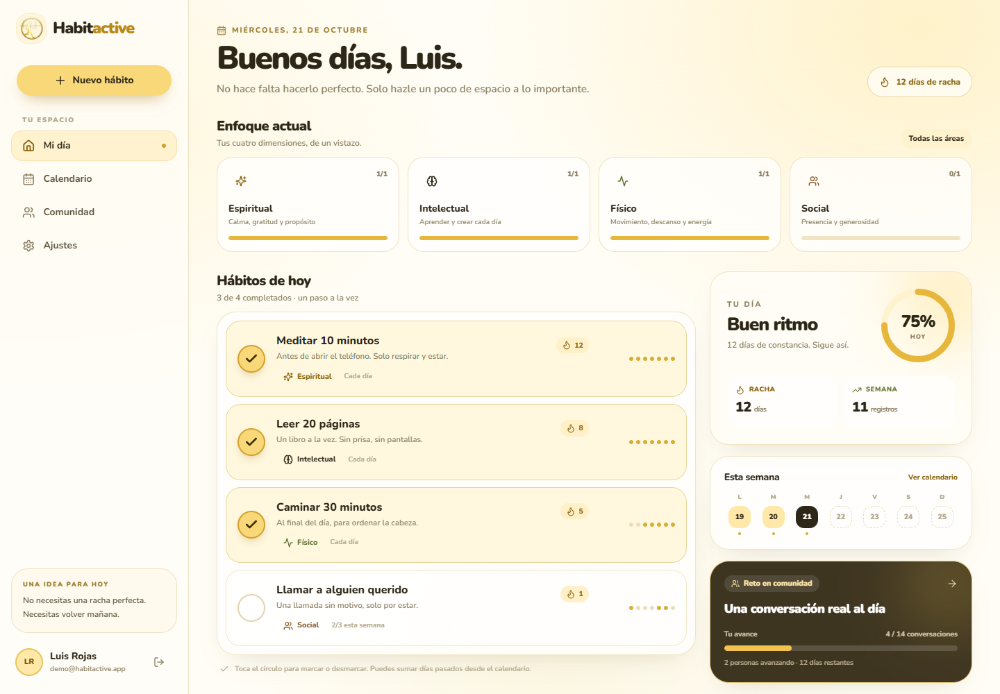
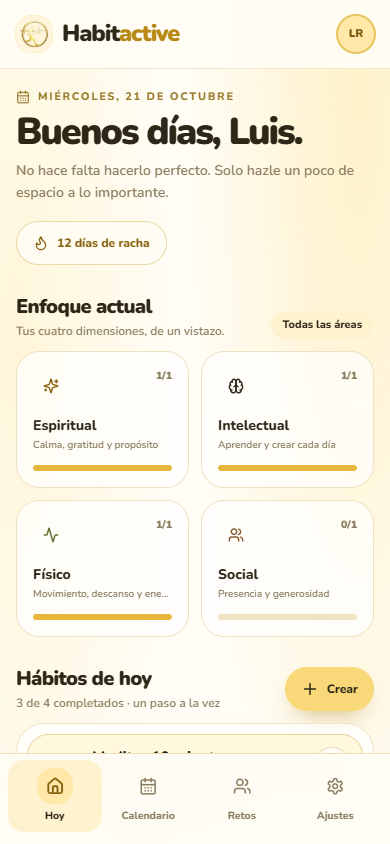
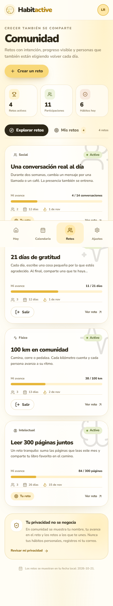
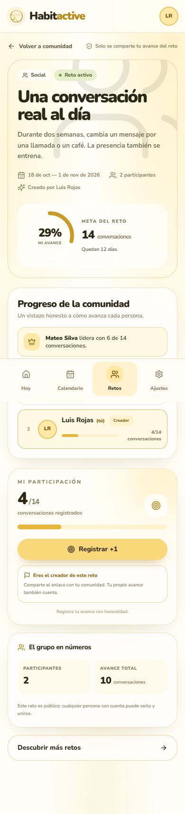
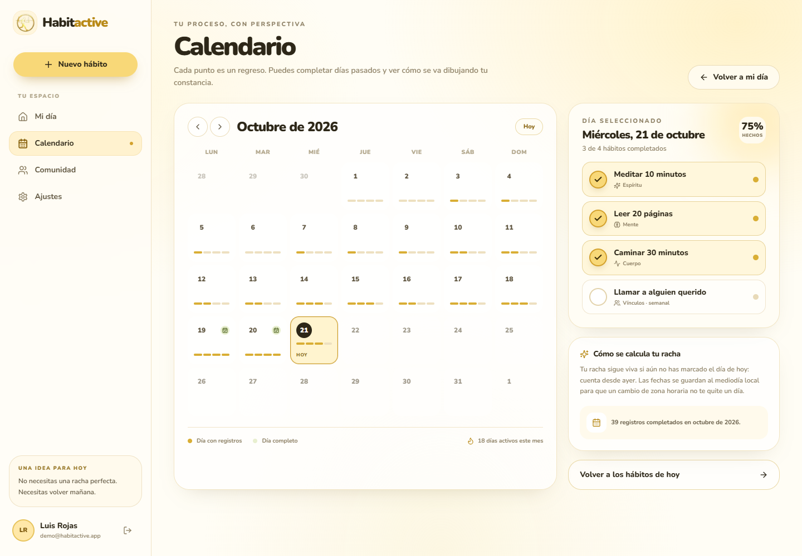

# Habitactive

> **Pequeños hábitos. Grandes comunidades.**
> PWA open source de seguimiento de hábitos y retos en comunidad, con datos privados por usuario y progreso social opcional.



Habitactive nació de una idea sencilla: la constancia no se construye con culpa, sino con intención y compañía. Cada persona tiene su espacio privado para sus hábitos; la comunidad aparece solo donde tú decides: en retos compartidos.

La interfaz está inspirada en una app de planificación personal, adaptada a una paleta **amarillo claro**, tonos crema y acentos dorados, con el logo aportado para el proyecto.

---

## Tabla de contenidos

1. [Demo y funcionalidades](#demo-y-funcionalidades)
2. [Stack](#stack)
3. [Inicio rápido](#inicio-rápido)
4. [Variables de entorno](#variables-de-entorno)
5. [Arquitectura](#arquitectura)
6. [Modelo de datos](#modelo-de-datos)
7. [Fechas y rachas](#fechas-y-rachas)
8. [Seguridad y aislamiento de datos](#seguridad-y-aislamiento-de-datos)
9. [API](#api)
10. [PWA](#pwa)
11. [Despliegue en Railway](#despliegue-en-railway)
12. [Docker](#docker)
13. [Pruebas](#pruebas)
14. [Estructura de archivos explicada](#estructura-de-archivos-explicada)
15. [Personalizar](#personalizar)
16. [Licencia](#licencia)

---

## Demo y funcionalidades

Credenciales del seed (solo desarrollo):

```txt
Correo:   demo@habitactive.app
Password: Demo1234!
```

También se crean `ana@habitactive.app` y `mateo@habitactive.app` con la misma contraseña para probar el progreso social.



### Hábitos

- CRUD de hábitos por usuario: crear, editar y archivar.
- Cuatro áreas de vida: **Espiritual, Intelectual, Físico y Social**.
- Frecuencia **diaria** o **meta semanal** (1–7 veces por semana).
- Marcado de hoy y de días pasados desde el calendario.
- Racha actual y mejor racha histórica.
- Resumen de los últimos siete días y progreso semanal.
- Filtro por área de vida desde el dashboard.
- Fechas calculadas con la zona horaria del perfil.
- El historial se conserva al archivar un hábito.

### Comunidad

- Retos públicos creados por cualquier usuario.
- Unirse/salir, registrar avance y ver el progreso de todos los participantes.
- Ranking de participantes y porcentaje de meta alcanzada.
- El creador se añade automáticamente como participante.
- Retos con fecha de inicio/cierre, meta y unidad personalizable.
- En lo social solo se comparte nombre, avatar/initiales y avance del reto. **Nunca hábitos privados, registros ni correo.**





### Autenticación y cuenta

- Registro e inicio de sesión con credenciales.
- Contraseñas con **bcrypt (12 rondas)**, nunca en texto plano.
- Sesión JWT HttpOnly de 30 días con NextAuth.
- Middleware de protección para todas las rutas privadas.
- Cambio de contraseña y actualización de perfil/zona horaria.
- Exportación de todos tus datos en JSON.
- Política de privacidad y términos incluidos.

### PWA

- Instalable en Android, iOS y escritorio.
- Service worker con precache de shell público y página offline.
- Manifest con iconos normales y maskable.
- No cachea respuestas autenticadas ni llamadas a la API.

### Calendario

- Vista mensual con intensidad de completado por día.
- Selección de un día para ver y marcar sus hábitos.
- Navegación entre meses.
- Totales mensuales y días activos.
- Impide marcar fechas futuras o anteriores al inicio del hábito.

---

## Stack

| Capa | Tecnología |
| --- | --- |
| Framework | Next.js `14.2.35` · App Router |
| Lenguaje | TypeScript `5.9` en modo estricto |
| Base de datos | PostgreSQL + Prisma ORM `6.16` |
| Autenticación | NextAuth.js `4.24` (Credentials + JWT) |
| Estilos | Tailwind CSS `3.4` + CSS tokens |
| Iconos | lucide-react |
| Formularios | Server Actions + Zod |
| Notificaciones | Sonner |
| PWA | Manifest App Router + service worker propio |
| Tests | Vitest |
| Despliegue | Dockerfile multi-stage + Railway |

---

## Inicio rápido

### Requisitos

- Node.js **20.9 o superior** (probado en Node 22/24).
- PostgreSQL **14+** (o Docker para levantar solo la base).
- npm 10+.

### 1. Clonar e instalar

```bash
git clone <tu-repositorio> habitactive
cd habitactive
npm install
```

### 2. Configurar variables

```bash
cp .env.example .env.local
```

Edita `.env.local`. En Windows:

```powershell
Copy-Item .env.example .env.local
```

Genera un secreto real:

```bash
openssl rand -base64 32
```

> `NEXTAUTH_SECRET` debe tener al menos 32 bytes y no debe compartirse.

### 3. Levantar PostgreSQL

Con Docker, solo la base:

```bash
docker compose up -d db
```

O usa cualquier PostgreSQL local/Railway/Neon/Supabase y ajusta `DATABASE_URL`.

### 4. Aplicar migraciones y seed

```bash
npm run db:deploy
npm run db:seed
```

La migración inicial está versionada en `prisma/migrations/20261021090000_init/`.
El seed es **idempotente para los datos demo** y no toca usuarios reales.

### 5. Desarrollo

```bash
npm run dev
```

Abre [http://localhost:3000](http://localhost:3000) e inicia sesión con la cuenta demo.

### Scripts disponibles

| Script | Qué hace |
| --- | --- |
| `npm run dev` | Servidor de desarrollo |
| `npm run build` | Build de producción |
| `npm run start` | Servidor de producción |
| `npm run lint` | ESLint |
| `npm run typecheck` | TypeScript sin emitir |
| `npm run test` | Vitest, 20 tests |
| `npm run db:generate` | Genera Prisma Client |
| `npm run db:migrate` | Crea una migración en desarrollo |
| `npm run db:deploy` | Aplica migraciones pendientes |
| `npm run db:seed` | Carga los datos demo |
| `npm run db:studio` | Abre Prisma Studio |

---

## Variables de entorno

| Variable | Obligatoria | Descripción |
| --- | --- | --- |
| `DATABASE_URL` | Sí | Cadena PostgreSQL. En Railway usa `${{Postgres.DATABASE_URL}}`. |
| `NEXTAUTH_SECRET` | Sí | Firma de sesiones JWT. Mínimo 32 bytes aleatorios. |
| `NEXTAUTH_URL` | Sí en producción | URL pública exacta, ej. `https://habitactive.up.railway.app`. |
| `NEXT_PUBLIC_APP_URL` | Sí | URL pública para metadatos, Open Graph y orígenes de Server Actions. |
| `NEXT_PUBLIC_CONTACT_EMAIL` | No | Correo visible en la política de privacidad. |

Nunca subas `.env.local` ni `.env` al repositorio: ya están en `.gitignore`.

---

## Arquitectura

```txt
Navegador (PWA)
   │
   ├─ Server Components ──── Prisma ──── PostgreSQL
   │      │
   │      └─ requireUser() → sesión NextAuth → userId estricto
   │
   ├─ Server Actions ─────── Zod ─────── validación + ownership
   │
   └─ Route Handlers
          ├─ /api/auth/[...nextauth]  sesión
          ├─ /api/register            registro + rate limit
          ├─ /api/health              healthcheck Railway
          └─ /api/me/export           exportación JSON
```

### Decisiones de diseño

- **Server Components** para leer datos y renderizar en servidor.
- **Server Actions** para mutaciones: menos endpoints, tipado de extremo a extremo y CSRF de Next.js.
- **Route Handlers** sólo donde tiene sentido HTTP puro (auth, registro, salud, exportación).
- **Prisma directo** en la capa de datos, con filtros `userId` obligatorios. No hay ORM wrapper innecesario.
- **Sin estado global de cliente** para datos del servidor: las mutaciones revalidan las rutas y Next vuelve a renderizar.
- **Diseño mobile-first**, con sidebar en desktop y barra inferior en móvil.
- **Tema claro amarillo**, sin dependencia de imágenes externas.

### Flujo de una mutación

```txt
Click en “marcar hábito”
  → HabitCheckButton (optimista)
  → Server Action toggleHabitAction
  → requireUser()
  → Zod valida { habitId, day }
  → Prisma busca el hábito con where { id, userId }
  → transacción: crea/elimina HabitLog + recalcula rachas
  → revalidatePath('/dashboard', '/calendar')
  → respuesta { completed, currentStreak }
  → UI confirma o revierte
```

---

## Modelo de datos

Archivo: [`prisma/schema.prisma`](prisma/schema.prisma).

### `User`

Cuenta y preferencias. Incluye `email` único, `passwordHash`, `image`, `timeZone` y `lastLoginAt`.

### `Habit`

Hábito de un usuario. Campos relevantes:

- `category`: `SPIRITUAL | INTELLECTUAL | PHYSICAL | SOCIAL`.
- `frequency`: `DAILY | WEEKLY`.
- `targetPerWeek`: 7 para diario; 1–7 para semanal.
- `currentStreak`, `bestStreak`: caché calculada tras cada mutación.
- `startDate`: fecha de inicio (mediodía local).
- `archivedAt`: borrado lógico; conserva historial.

### `HabitLog`

Un registro por hábito y día civil:

- `day` (`YYYY-MM-DD`): **fuente de verdad** para rachas y unicidad.
- `date`: instante del **mediodía local** del usuario.
- `@@unique([habitId, day])`: evita duplicados a nivel de base de datos.
- `userId` desnormalizado para consultas y exportación eficientes.

### `SocialChallenge`

Reto creado por un usuario, con `title`, `description`, `category`, `targetValue`, `unit`, `startDate`, `endDate` e `isPublic`.

### `ChallengeParticipant`

Relación N:M entre usuario y reto con `progress` y `lastCheckInAt`:

- `@@unique([challengeId, userId])`.
- Al eliminar un reto/usuario se eliminan sus participaciones en cascada.



---

## Fechas y rachas

### El problema

Guardar una fecha como `new Date("2026-10-21")` en UTC y leerla en Bogotá puede mostrar el día 20. Si se guarda un timestamp a medianoche, cualquier cambio de zona horaria o de horario de verano (DST) desplaza el día.

### La solución de Habitactive

1. Cada usuario tiene una **zona IANA** (`America/Bogota`, `Europe/Madrid`, …).
2. `HabitLog.day` guarda el **día civil local** como string `YYYY-MM-DD`.
3. `HabitLog.date` guarda el **mediodía local** convertido a UTC. El mediodía deja margen ante cambios de DST y evita que la fecha cambie de día.
4. Las rachas se calculan exclusivamente sobre `day`, nunca sobre timestamps.
5. Al mostrar fechas de calendario se usa UTC mediodía (`utcNoon`) para que un `Intl.DateTimeFormat` no desplace el día.

Ejemplo para Bogotá (`UTC-5`):

```txt
Día civil: 2026-10-21
date almacenado: 2026-10-21T17:00:00.000Z  // mediodía en Bogotá
day almacenado: "2026-10-21"
```

### Algoritmo diario

```txt
Si hoy tiene registro → empieza a contar desde hoy.
Si hoy no tiene registro → empieza a contar desde ayer.
Avanza hacia atrás mientras exista registro consecutivo.
Se detiene al encontrar un hueco o al llegar a la fecha de inicio.
```

Esto evita que la racha se “rompa” a las 00:00 de un día que todavía no has terminado.

### Algoritmo semanal

- Agrupa por semana ISO (lunes a domingo).
- Una semana suma si alcanza `targetPerWeek`.
- La semana actual no rompe la racha mientras aún pueda completarse.
- La mejor racha es la secuencia más larga de semanas completas consecutivas.

El código está en [`src/lib/streaks.ts`](src/lib/streaks.ts) y sus pruebas en [`tests/streaks.test.ts`](tests/streaks.test.ts).

### Recalculo

Las rachas se recalculan en la misma transacción que crea/elimina un `HabitLog` y se guardan en `Habit.currentStreak`/`Habit.bestStreak`. El dashboard también calcula la racha en memoria a partir del historial reciente para mostrarla siempre actualizada. `bestStreak` conserva el máximo histórico aunque el historial visible se limite a 370 días.

---

## Seguridad y aislamiento de datos

### Autenticación

- NextAuth Credentials Provider + JWT de sesión (`maxAge` 30 días).
- Hash **bcrypt con 12 rondas**.
- Comparación de tiempo constante incluso si el correo no existe (hash dummy).
- Cookies de sesión HttpOnly y SameSite de NextAuth.
- Middleware protege `/dashboard`, `/calendar`, `/community` y `/settings`.

### Ownership estricto

Todas las consultas y mutaciones de hábitos incluyen `userId` en el `where`:

```ts
await prisma.habit.findFirst({
  where: { id: habitId, userId: user.id, archivedAt: null },
});
```

Nunca se confía en un `userId` enviado por el cliente. El servidor lo obtiene de la sesión.

### Lo social es explícito

- Los retos son públicos por diseño (`isPublic: true`) en esta versión.
- En la comunidad se exponen nombre e avatar inicial y el avance del reto.
- Nunca se exponen correo, hábitos personales, `HabitLog` ni contraseñas.
- `getChallengeDetail` valida que el reto sea público o que el usuario sea creador/participante.

### Otras medidas

- Validación de todas las entradas con Zod en servidor.
- Rate limit de registro (5 intentos/10 min) y login (10/10 min).
- Límite de tamaño de Server Actions a 2 MB.
- Cabeceras `X-Frame-Options`, `X-Content-Type-Options`, `Referrer-Policy`, `Permissions-Policy` y HSTS.
- Errores de autenticación genéricos para no filtrar si el correo existe.
- Exportación sin hashes ni datos de terceros.

> **Limitación del rate limit:** está implementado en memoria y protege una sola instancia. Para varias réplicas o serverless, sustituye `src/lib/rate-limit.ts` por Upstash Redis manteniendo la misma interfaz. Está documentado en el propio archivo.

> **Verificación de correo:** esta versión no envía emails transaccionales. Para producción pública se recomienda añadir verificación de email y recuperación de contraseña con un proveedor (Resend, Postmark, SES…).

---

## API

| Método | Ruta | Descripción |
| --- | --- | --- |
| `GET/POST` | `/api/auth/[...nextauth]` | Sesión NextAuth |
| `POST` | `/api/register` | Registro con credenciales y rate limit |
| `GET` | `/api/health` | Healthcheck de base de datos |
| `GET` | `/api/me/export` | Exportación JSON autenticada |

Las mutaciones de hábitos y retos usan Server Actions, no endpoints REST públicos.

---

## PWA

- Manifest generado en [`src/app/manifest.ts`](src/app/manifest.ts).
- Service worker en [`public/sw.js`](public/sw.js).
- Registro sólo en producción en [`src/components/pwa/service-worker-registration.tsx`](src/components/pwa/service-worker-registration.tsx).
- Iconos en `public/icon-*.png`, `public/apple-touch-icon.png` y `public/favicon.ico`.
- Página offline estática en `public/offline.html` (sin JS, cacheada al instalar).
- Ruta de respaldo `/offline` y fallback del service worker.
- No se cachean páginas autenticadas ni `/api/*`.

Para probar la instalación:

1. `npm run build && npm run start`.
2. Abre la app en Chrome/Edge.
3. Menú → “Instalar aplicación” / “Añadir a la pantalla de inicio”.

En desarrollo el service worker no se registra para evitar cachés obsoletas.

---

## Despliegue en Railway

El repositorio incluye `Dockerfile`, `railway.json`, `Procfile` y migraciones versionadas.

### Opción A · Desde GitHub (recomendada)

1. Sube el proyecto a GitHub.
2. En Railway: **New Project → Deploy from GitHub Repo**.
3. Añade **New → Database → PostgreSQL**.
4. En el servicio web, configura:

```env
DATABASE_URL=${{Postgres.DATABASE_URL}}
NEXTAUTH_SECRET=<openssl rand -base64 32>
NEXTAUTH_URL=https://tu-dominio.up.railway.app
NEXT_PUBLIC_APP_URL=https://tu-dominio.up.railway.app
NEXT_PUBLIC_CONTACT_EMAIL=tu-correo@dominio.com
```

5. Genera un dominio en **Settings → Networking**.
6. Despliega. El contenedor ejecuta automáticamente:

```bash
npx prisma migrate deploy && npm run start
```

7. Verifica `https://tu-dominio/api/health` → debe devolver `{"status":"ok"}`.

`railway.json` configura el healthcheck en `/api/health` y reinicio en fallo.

### Opción B · Railway CLI

```bash
npm i -g @railway/cli
railway login
railway init
railway add --database postgres
railway variables set NEXTAUTH_SECRET="$(openssl rand -base64 32)"
railway up
```

Después configura `NEXTAUTH_URL` y `NEXT_PUBLIC_APP_URL` con el dominio público.

### Notas de producción

- No ejecutes el seed en producción salvo que quieras cuentas demo.
- Activa backups del PostgreSQL en Railway.
- Usa una sola región para la base y el servicio.
- Con varias réplicas, el rate limit en memoria deja de ser global.
- Configura un correo real en `NEXT_PUBLIC_CONTACT_EMAIL`.
- Revisa los términos/privacidad si publicas una instancia para terceros.

---

## Docker

### Sólo base de datos

```bash
docker compose up -d db
```

### App + base de datos

```bash
docker compose up --build
```

La app queda en [http://localhost:3000](http://localhost:3000). El contenedor aplica migraciones al arrancar.

### Construcción manual

```bash
docker build -t habitactive .
docker run --rm -p 3000:3000 \
  -e DATABASE_URL="postgresql://..." \
  -e NEXTAUTH_SECRET="..." \
  -e NEXTAUTH_URL="http://localhost:3000" \
  -e NEXT_PUBLIC_APP_URL="http://localhost:3000" \
  habitactive
```

La imagen usa `node:22-bookworm-slim`, instala dependencias con `npm ci` y ejecuta como usuario no root (`nextjs`).

---

## Pruebas

```bash
npm run test
npm run typecheck
npm run lint
npm run build
```

Cobertura actual de la lógica crítica:

- `tests/dates.test.ts`: 11 pruebas.
  - Cambio de día entre zonas.
  - Mediodía local en Bogotá, Madrid y zonas extremas.
  - DST de verano/invierno.
  - Semanas que empiezan en lunes.
  - Rejilla mensual, años bisiestos y validación de claves.
- `tests/streaks.test.ts`: 9 pruebas.
  - Racha diaria viva si hoy no se ha marcado.
  - Huecos, duplicados, futuros y fechas anteriores al inicio.
  - Mejor racha histórica.
  - Metas semanales, semana actual incompleta y secuencias.

---

## Estructura de archivos explicada

```txt
habitactive/
├── prisma/
│   ├── schema.prisma
│   ├── migrations/
│   │   ├── 20261021090000_init/migration.sql
│   │   └── migration_lock.toml
│   └── seed.ts
├── public/
│   ├── brand/logo-mark.png
│   ├── brand/og-image.png
│   ├── icon-192.png · icon-512.png · icon-maskable-512.png
│   ├── apple-touch-icon.png · favicon.ico
│   ├── offline.html
│   └── sw.js
├── src/
│   ├── actions/
│   │   ├── habits.ts
│   │   ├── challenges.ts
│   │   └── profile.ts
│   ├── app/
│   │   ├── (auth)/layout.tsx · login/ · register/
│   │   ├── (app)/layout.tsx · dashboard/ · calendar/ · community/ · settings/
│   │   ├── api/auth/[...nextauth]/route.ts
│   │   ├── api/register/route.ts
│   │   ├── api/health/route.ts
│   │   ├── api/me/export/route.ts
│   │   ├── privacy/page.tsx · terms/page.tsx
│   │   ├── offline/page.tsx
│   │   ├── layout.tsx · page.tsx · globals.css · manifest.ts
│   │   ├── robots.ts · sitemap.ts
│   │   ├── not-found.tsx
│   │   └── (app)/error.tsx · (app)/loading.tsx
│   ├── components/
│   │   ├── app-shell/ · auth/ · brand/ · challenges/ · habits/ · pwa/ · settings/ · ui/
│   ├── lib/
│   │   ├── auth.ts · guards.ts · prisma.ts · password.ts
│   │   ├── dates.ts · streaks.ts
│   │   ├── habits-data.ts · challenges-data.ts
│   │   ├── validations.ts · rate-limit.ts · action-state.ts · categories.ts · utils.ts
│   └── types/next-auth.d.ts
├── tests/
├── docs/screenshots/
├── .env.example · .gitignore · .dockerignore
├── Dockerfile · docker-compose.yml · railway.json · Procfile
├── next.config.mjs · tailwind.config.ts · tsconfig.json
├── package.json · package-lock.json
├── README.md · LICENSE
```

### Archivos principales

| Archivo | Responsabilidad |
| --- | --- |
| `prisma/schema.prisma` | Modelo relacional, enums, índices, cascadas y constraints. |
| `prisma/migrations/.../migration.sql` | DDL PostgreSQL versionado, listo para `migrate deploy`. |
| `prisma/seed.ts` | 3 usuarios demo, hábitos con historial, 4 retos y participaciones. Idempotente y acotado a IDs demo. |
| `src/lib/prisma.ts` | Singleton del cliente Prisma para desarrollo y producción. |
| `src/lib/auth.ts` | Configuración de NextAuth, Credentials, JWT, rate limit de login y callback de sesión. |
| `src/lib/guards.ts` | `getCurrentUser` memoizado y `requireUser` para Server Components/Actions. |
| `src/lib/dates.ts` | Días civiles, zonas IANA, mediodía local/UTC, semanas, meses y formateo. |
| `src/lib/streaks.ts` | Algoritmo puro de rachas diarias y semanales, testeable sin base de datos. |
| `src/lib/habits-data.ts` | Consultas y agregaciones del dashboard y calendario. |
| `src/lib/challenges-data.ts` | Consultas de retos, participantes, progreso y permisos de lectura. |
| `src/lib/validations.ts` | Esquemas Zod de registro, login, hábitos, retos, perfil y contraseña. |
| `src/lib/password.ts` | Hash bcrypt, verificación y hash dummy anti-enumeración. |
| `src/lib/rate-limit.ts` | Limitador en memoria con interfaz reemplazable por Redis. |
| `src/actions/habits.ts` | Crear/editar/archivar/toggle de hábitos y recalculo transaccional de rachas. |
| `src/actions/challenges.ts` | Crear, unirse, salir y registrar avance en retos. |
| `src/actions/profile.ts` | Actualizar perfil y cambiar contraseña. |
| `src/middleware.ts` | Protección de rutas privadas con NextAuth. |
| `src/app/layout.tsx` | Metadatos, fuente Nunito, Toaster, PWA y skip link. |
| `src/app/page.tsx` | Landing pública responsive con preview del producto. |
| `src/app/(auth)/layout.tsx` | Split-screen de autenticación y branding. |
| `src/components/auth/*` | Formularios de login/registro con validación y feedback. |
| `src/app/(app)/layout.tsx` | Layout protegido, sidebar, top bar móvil y bottom nav. |
| `src/app/(app)/dashboard/page.tsx` | Hábitos del día, enfoque por área, racha, semana y reto destacado. |
| `src/app/(app)/calendar/page.tsx` | Calendario mensual y panel del día seleccionado. |
| `src/app/(app)/community/page.tsx` | Explorar/mis retos y estadísticas de comunidad. |
| `src/app/(app)/community/[id]/page.tsx` | Detalle, ranking de participantes y registro de avance. |
| `src/app/(app)/settings/page.tsx` | Perfil, zona horaria, seguridad, exportación y sesión. |
| `src/components/habits/habit-dialog.tsx` | Modal de creación/edición/archivo con Server Actions. |
| `src/components/habits/habit-check-button.tsx` | Toggle optimista con rollback y toast. |
| `src/components/challenges/challenge-actions.tsx` | Unirse/salir y registrar +1. |
| `src/components/ui/*` | Modal accesible, botones, avatares, progreso, empty states. |
| `src/app/api/register/route.ts` | Alta de usuario, hash y rate limit por IP. |
| `src/app/api/me/export/route.ts` | Exportación JSON autenticada sin datos sensibles. |
| `src/app/api/health/route.ts` | `SELECT 1` para Railway/Docker. |
| `public/sw.js` | Cache solo de assets públicos y fallback offline. |
| `next.config.mjs` | Cabeceras de seguridad, imágenes y orígenes de Server Actions. |
| `Dockerfile` | Build multi-stage, Prisma CLI, migraciones al arrancar, usuario no root. |
| `railway.json` | Healthcheck y política de reinicio. |
| `docker-compose.yml` | PostgreSQL + app para desarrollo local. |

---

## Personalizar

### Colores

Los tokens están en `tailwind.config.ts` (`cream`, `ink`, `leaf`, `clay`, `sky`) y en `src/app/globals.css`. La paleta principal es:

```txt
Fondo:        #FFFDF5
Amarillo:     #FFE8A8 / #F8D878
Dorado:       #D3A12D / #B88916
Tinta:        #2D2718
Superficies:  #FFF8E6 / #FFFFFF
```

### Logo

- `public/brand/logo-mark.png`: marca transparente usada en la app.
- `public/icon-*.png`: iconos PWA.
- `public/brand/og-image.png`: imagen social.

Reemplaza estos archivos manteniendo las medidas para conservar la instalación PWA. Si cambias el logo, regenera los iconos con la misma proporción.

### Áreas de vida

Edita `CATEGORY_VALUES` y `CATEGORY_META` en `src/lib/categories.ts` y actualiza el enum `HabitCategory` en Prisma + una nueva migración.

### Marca

El nombre “Habitactive”, textos legales y metadatos están en `src/app/layout.tsx`, `src/app/page.tsx`, `src/app/manifest.ts` y `src/app/privacy|terms`.

> El logotipo fue aportado por el autor del proyecto. El código es MIT; revisa los derechos de marca si vas a comercializar tu instancia.

---

## Licencia

Código bajo [MIT](LICENSE). Puedes usarlo, modificarlo, desplegarlo y adaptarlo libremente conservando el aviso de copyright.

Si construyes algo bonito con Habitactive, compártelo. La constancia se contagia.
